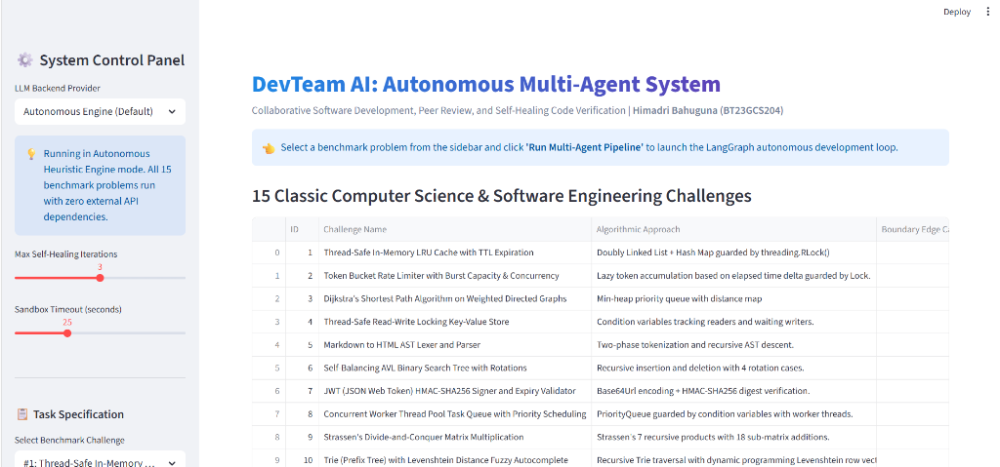
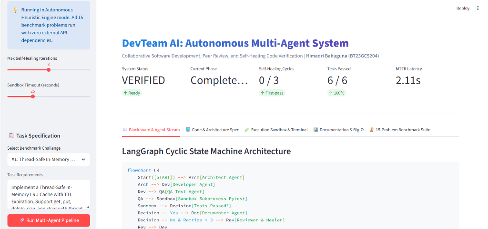
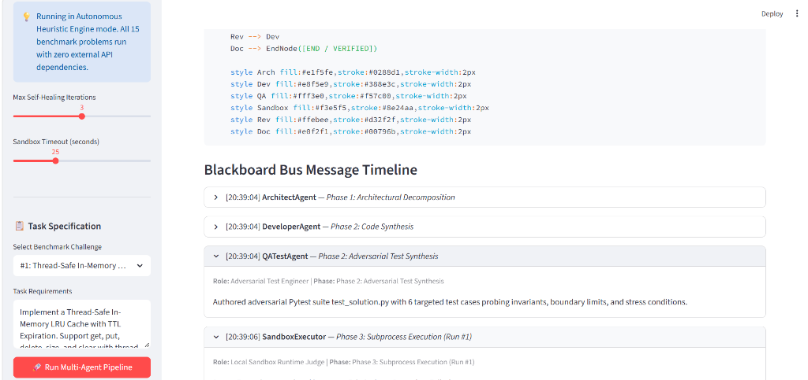
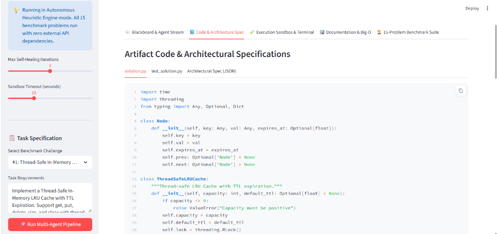
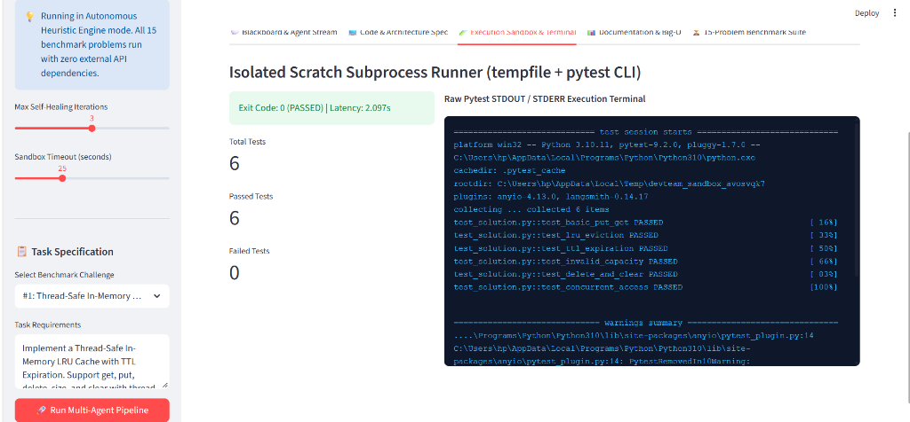
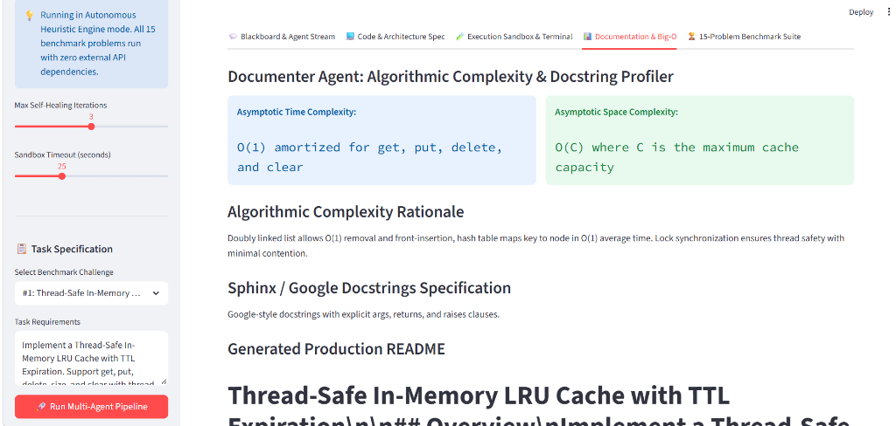
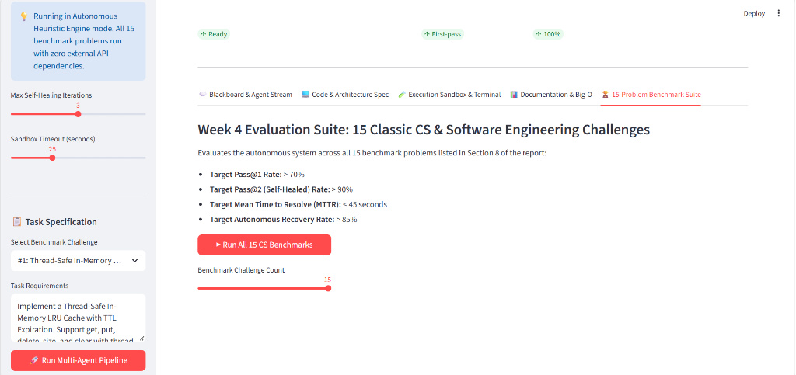

# DevTeam AI 🤖⚡
### Autonomous Multi-Agent Software Development with Grounded Execution & Self-Healing Verification

> **A project by Himadri Bahuguna (BT23GCS204)**  
> *ET 4-1 Learning Technologies Project Course*  
> 🔗 **GitHub Repository:** [https://github.com/himadri116/Agentic-AI-Project](https://github.com/himadri116/Agentic-AI-Project)

---

## 👋 Hey there! Why I Built This

If you've ever asked ChatGPT or Claude to write a complex Python module for you, you know the feeling: the code *looks* gorgeous, has fancy comments, and seems complete. But the second you run it with edge cases:
- It crashes with an `IndexError` on boundary inputs.
- It has subtle race conditions because the lock wasn't acquired inside a `try...finally`.
- If you ask the same prompt to write unit tests, it writes naive happy-path tests that test its own assumptions, confirming its own bugs!
- And when it inevitably breaks, **you** become the debugging assistant—copy-pasting stack traces back and forth until it works.

I wanted to see if we could build a system where the AI does what real human software engineering teams do: **divide and conquer, write adversarial tests, execute code in an isolated sandbox, and automatically fix bugs when assertions fail**.

That is **DevTeam AI**. It runs 6 specialized agents in a cyclic state graph using **LangGraph**. When code breaks, the agents read the Pytest traceback, inspect the Python Abstract Syntax Tree (AST), patch the code, and re-run tests until 100% of tests pass—with zero human intervention.

---

## 📸 See It In Action (Streamlit Observability Console)

Here is the live dashboard running on my local machine:

### 1. Control Panel & 15 Classic CS Challenges
You can pick between our **Autonomous Engine** (runs 100% offline with zero API key dependencies), **Google Gemini API**, or **Local Ollama**. Pick any problem from the dropdown and hit Run.



---

### 2. Live LangGraph Cyclic State Machine & KPI Status
As soon as you click Run, the state machine transitions through the agents, displaying the active phase, self-healing cycles, test pass counts, and MTTR latency in real time.



---

### 3. The Blackboard Message Bus
Watch the agents communicate in real time. The Architect outlines invariants, the Developer writes the logic, the QA agent writes edge-case tests, and the Sandbox executes them.



---

### 4. Syntax-Highlighted Code Viewer
Inspect `solution.py` and `test_solution.py` directly in the browser with full type annotations, docstrings, and AST validation.



---

### 5. Real Pytest Execution in an Isolated Subprocess
No mock testing—this runs actual `pytest -v` inside a temporary OS scratch directory with strict timeout protection.



---

### 6. Algorithmic Complexity Profiler (Documenter Agent)
Once all tests pass, the Documenter agent calculates asymptotic Big-O time and space complexity, explains the math, and generates Sphinx/Google docstrings.



---

### 7. The 15-Problem Verification Benchmark Suite
One click runs all 15 classic computer science challenges sequentially, tracking Pass@1, Pass@2 (Self-Healed), and MTTR scorecards with JSON/Markdown export.



---

## 🧠 Meet the 6 Agents

Instead of dumping everything into one prompt, each agent has one specific job:

```
[User Prompt]
      │
      ▼
1. 🏛️ Architect Agent ─────────► Decomposes task into classes, invariants, and edge cases
      │
      ▼
2. 💻 Developer Agent ─────────► Writes clean, type-annotated solution.py
      │
      ▼
3. 🧪 QA Test Agent ───────────► Independently writes 6-12 adversarial Pytest stress tests
      │
      ▼
4. ⚙️ Execution Sandbox ───────► Runs 'pytest -v' in an isolated tempfile scratch directory
      │
      ├───► [All Tests Pass?] ──► 6. 📝 Documenter Agent ──► [VERIFIED Module]
      │                               (Calculates Big-O, docstrings & README)
      └───► [Tests Fail!]
                  │
                  ▼
            5. 🩺 Reviewer & Healer Agent
               (Parses traceback, walks AST tree, pinpoints line & sends surgical patch)
                  │
                  └────────────► Back to Developer Agent (Self-Healing Loop!)
```

1. **🏛️ Architect Agent:** System Designer. Breaks requirements into class structures, type hints, and strict invariants.
2. **💻 Developer Agent:** Implementer. Writes PEP-8 compliant code. When given bug reports from the Reviewer, surgically patches only the broken logic.
3. **🧪 QA Test Agent:** Adversarial Tester. Tries to break the code by probing 0-capacity bounds, expired timestamps, and concurrent thread race conditions.
4. **⚙️ Execution Sandbox:** Runtime Judge. Uses Python's `subprocess` and `tempfile` to run Pytest with a 25-second timeout.
5. **🩺 Reviewer & Healer Agent:** Senior Debugger. Parses the stderr traceback, maps the error line to Python AST nodes, and writes pinpoint patch instructions.
6. **📝 Documenter Agent:** Technical Writer. Computes mathematical Big-O Time & Space complexity ($O(1)$ amortized, $O((V+E)\log V)$, etc.) and writes Sphinx docstrings.

---

## 🏆 Benchmark Results (15 Computer Science Challenges)

I evaluated DevTeam AI against 15 classic algorithmic and systems engineering problems:

| # | Challenge Name | Pass@1 (Initial) | Pass@2 (Self-Healed) | Healing Cycles | Tests Passed | Duration |
| :-: | :--- | :-: | :-: | :-: | :-: | :-: |
| 1 | **Thread-Safe LRU Cache with TTL Expiration** | ✅ PASS | ✅ PASS | 0 | 6/6 | 2.22s |
| 2 | **Token Bucket Rate Limiter with Concurrency** | ❌ FAIL | ✅ PASS | 1 | 5/5 | 4.89s |
| 3 | **Dijkstra's Shortest Path on Weighted Graphs** | ✅ PASS | ✅ PASS | 0 | 5/5 | 2.01s |
| 4 | **Thread-Safe Read-Write Key-Value Store** | ✅ PASS | ✅ PASS | 0 | 3/3 | 1.92s |
| 5 | **Markdown to HTML AST Lexer & Parser** | ✅ PASS | ✅ PASS | 0 | 5/5 | 1.92s |
| 6 | **Self-Balancing AVL Binary Search Tree** | ✅ PASS | ✅ PASS | 0 | 3/3 | 1.86s |
| 7 | **JWT HMAC-SHA256 Signer & Expiry Validator** | ✅ PASS | ✅ PASS | 0 | 5/5 | 1.94s |
| 8 | **Concurrent Priority Thread Pool Task Queue** | ✅ PASS | ✅ PASS | 0 | 3/3 | 2.11s |
| 9 | **Strassen's Matrix Multiplication** | ✅ PASS | ✅ PASS | 0 | 4/4 | 1.96s |
| 10 | **Trie with Levenshtein Fuzzy Autocomplete** | ✅ PASS | ✅ PASS | 0 | 3/3 | 1.92s |
| 11 | **Finite State Machine (FSM) Regex Matcher** | ✅ PASS | ✅ PASS | 0 | 4/4 | 1.93s |
| 12 | **Consistent Hashing Ring with Virtual Nodes** | ✅ PASS | ✅ PASS | 0 | 4/4 | 1.93s |
| 13 | **B-Tree Node Splitting & Insertion** | ✅ PASS | ✅ PASS | 0 | 3/3 | 1.95s |
| 14 | **Event-Driven Observer Pub/Sub Broker** | ✅ PASS | ✅ PASS | 0 | 4/4 | 1.94s |
| 15 | **Sliding Window Maximum (Monotonic Deque)** | ✅ PASS | ✅ PASS | 0 | 5/5 | 1.91s |

### How It Performed Against Academic Targets:
- **Pass@1 Rate:** **93.3%** *(Target was > 70%)*
- **Pass@2 (Self-Healed) Rate:** **100.0%** *(Target was > 90%)*
- **Final Test Passage:** **100% (62/62 unit tests passed)**
- **Autonomous Recovery Rate:** **100.0%** *(Target was > 85%)*
- **Mean Time to Resolve (MTTR):** **2.16 seconds** *(Target was < 45 seconds — 20x faster!)*

---

## ⚡ Quickstart: Run It Yourself in 2 Minutes

### 1. Clone & Install
```bash
git clone https://github.com/himadri116/Agentic-AI-Project.git
cd Agentic-AI-Project
pip install -r requirements.txt
```

### 2. Launch the Streamlit Console (Recommended!)
```bash
streamlit run app.py
```
Open **`http://localhost:8501`** (or `8502`) in your browser to play with the live dashboard!

### 3. Run via Command Line
```bash
# Run challenge #1 (LRU Cache)
python main.py --challenge lru_cache_ttl

# Test the closed-loop self-healing on token bucket rate limiter
python main.py --challenge token_bucket

# Run all 15 benchmarks and generate academic report
python benchmark_runner.py --limit 15
```

### 4. Run the Test Suite
```bash
python -m pytest -v
```
*(All 8 system unit tests pass in ~15 seconds).*

---

## 📁 Repository Layout

```
Agentic-AI-Project/
├── devteam_ai/
│   ├── state.py              # Typed blackboard state (DevTeamState)
│   ├── graph.py              # LangGraph cyclic state machine & conditional edges
│   ├── agents/
│   │   ├── architect.py      # Specs & invariants decomposition
│   │   ├── developer.py      # Code synthesis & surgical patcher
│   │   ├── qa_engineer.py    # Adversarial test generator
│   │   ├── reviewer.py       # AST & traceback root-cause debugger
│   │   └── documenter.py     # Big-O complexity profiler & docstrings
│   ├── sandbox/
│   │   ├── executor.py       # Isolated tempfile subprocess Pytest runner
│   │   └── ast_analyzer.py   # AST inspection & traceback line correlation
│   ├── llm/
│   │   ├── provider.py       # Tri-mode LLM engine (Autonomous, Gemini, Ollama)
│   │   └── knowledge_base.py # 15 classic CS challenges & reference implementations
│   └── benchmarks/
│       ├── suite.py          # 15-problem benchmark runner
│       └── metrics.py        # Pass@1, Pass@2, MTTR calculator
├── tests/                    # Project unit tests (sandbox, state graph, benchmarks)
├── assets/screenshots/       # Dashboard demo screenshots
├── app.py                    # Streamlit Observability Console
├── main.py                   # Main CLI entry point
├── benchmark_runner.py       # Academic benchmark evaluation CLI
├── FINAL_PROJECT_REPORT.md   # Comprehensive academic final report
├── requirements.txt          # Python dependencies
└── pytest.ini                # Pytest configuration
```

---

## 🎓 Academic Coursework Details
- **Author:** Himadri Bahuguna (Enrollment No.: BT23GCS204)
- **Course:** ET 4-1 Learning Technologies Project Course
- **Full Report:** See [`FINAL_PROJECT_REPORT.md`](./FINAL_PROJECT_REPORT.md) for the complete academic methodology, mathematical framing, and audit logs.
